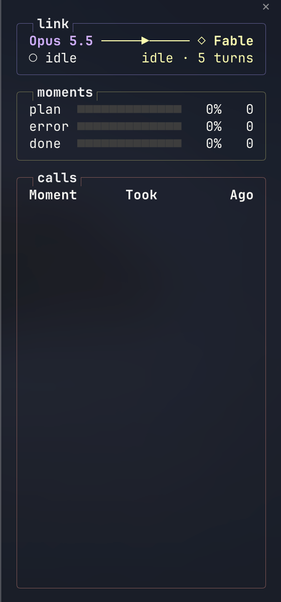

# advisor-live

A Claude Code mod that shows the advisor's activity live while you work: a status line entry and a side pane.

- **Status line**: `Sonnet 5.5 building`, then `Fable advisor ×2 · before the plan locks` after each advisor call.
- **Side pane**: opens with the session, or with `/advisor-live`, drawn in btop's style: a `link` box with the main model, the advisor and the turn's running time; a `latency` braille graph of recent calls with their max and average; a `moments` box metering the three moments the advisor wakes up (before the plan locks, same error twice, before calling it done); and a `calls` list, newest first, down to the pane's foot. A short pane, or the desktop app's minimized widget, folds it to three lines. `/clear` and `/resume` start the counts over.

Start a session with an advisor, for example `claude --model sonnet --advisor fable`.

## The pane



From the top:

- **link**: the main model on the left, the advisor on the right. Below them, the main model's state (`○ idle` between turns, a spinner and the running time while it builds) and the advisor's.
- **latency**: shown once there are calls. A braille graph of recent advisor calls, with the slowest and the average.
- **moments**: how many calls fell under each moment the advisor is meant to wake up, as a meter, a share and a count.
- **calls**: one row per call, newest first: the moment, how long it took and how long ago.

### Idle advisor

The screenshot shows an advisor that is set but never called. After three turns in a row that used tools with no advisor call, the advisor reads `idle · N turns`, in the pane and the status line, and the count keeps going until a call arrives. This usually means the advisor is less capable than the main model, here Fable under Opus 5.5, and so never activates. Pick a stronger advisor, or drop it. Switching either model starts the count over.

<br clear="right">

Switch either model mid-session with the built-in `/model` and `/advisor`; the pane follows. Both save the choice as your default for new sessions.

A mod can't read which advisor the session is using, so the pane works it out: at start from `--advisor` on the launch command line, else the `advisorModel` setting; after `/advisor`, from what it wrote to that setting. An advisor reading `Advisor` means calls are arriving but nothing named the model.

The advisor runs inside the API request, so the mod sees a call only after it finishes. There is no "consulting" state while it runs. The moment each call counts under is inferred from the turn, not reported by the advisor: the same tool failing twice in a row with the same message is "same error twice", a step that ends the turn is "before calling it done", a call before any file was written is "before the plan locks", and a call in between shows as a check-in in the recent list.

## Install

In a Claude Code session:

```
/plugin install advisor-live --marketplace iskerwin/advisor-live
```

From a shell:

```
claude plugin install advisor-live --marketplace iskerwin/advisor-live
```

Answer `y` to add the marketplace, then pick a scope.

## Update

From a shell, fetch the marketplace again, then update the plugin:

```
claude plugin marketplace update advisor-live
claude plugin update advisor-live
```

Restart running sessions to load the new version.

## License

MIT
